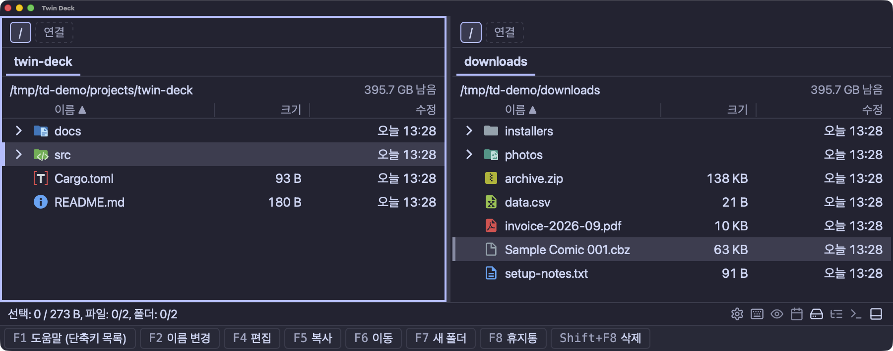
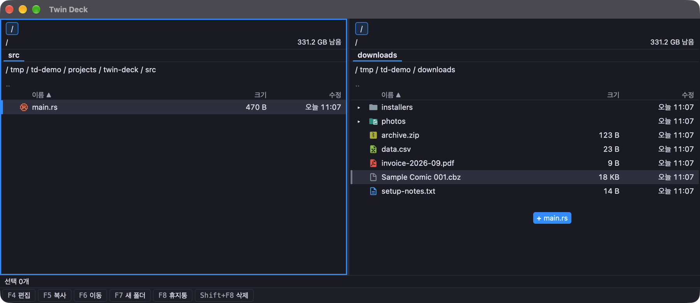
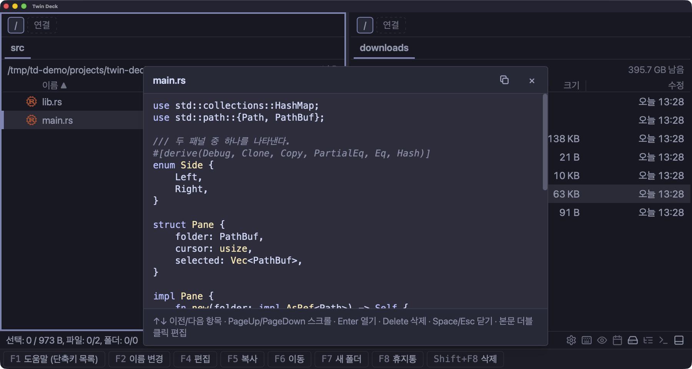
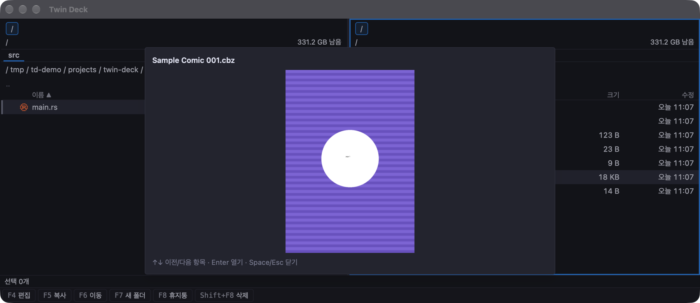
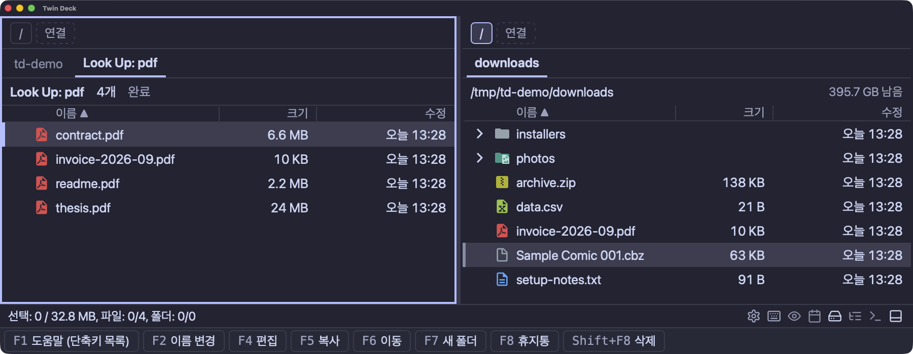
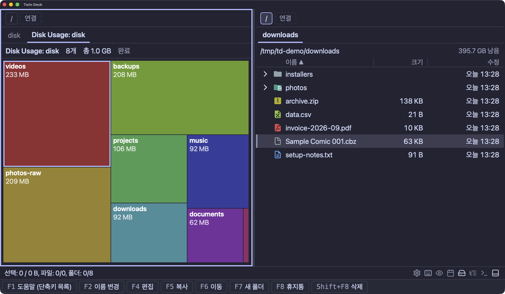
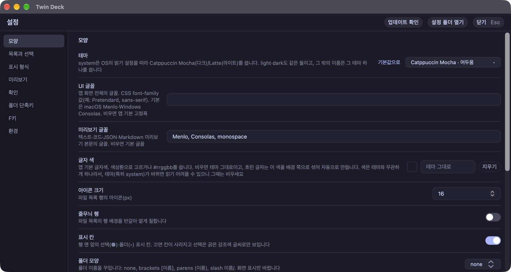
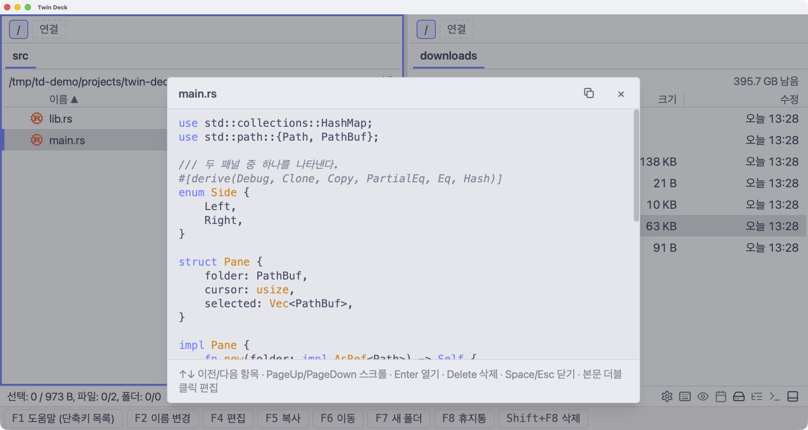
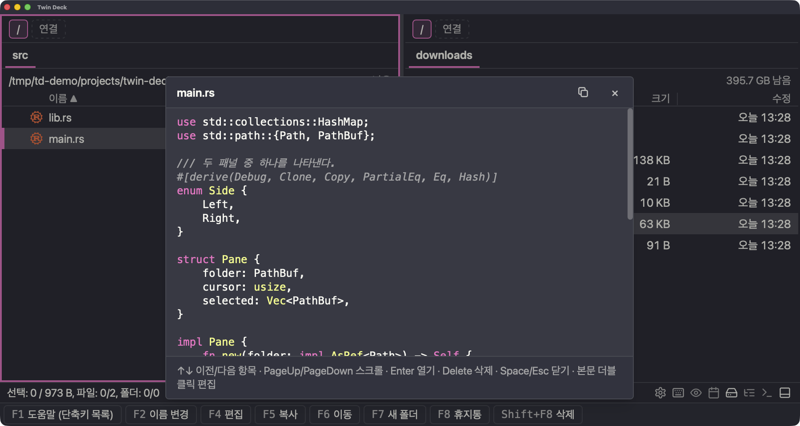

**English** | [한국어](README.md)

# Twin Deck

A file manager that puts two panes side by side so you can move and organize files. You can do almost everything from the keyboard alone, without a mouse.



- Copy from the left folder to the right folder with one `F5`, and move with `F6`.
- Look at a file's contents with the `→` key before opening it. Code, documents, images, PDFs, archives, comics, and videos are supported.
- See folder sizes at a glance as tiles proportional to size, search files by name or content, and move between folders with tabs.
- Change 112 color themes, fonts, and shortcuts, and choose the screen language between Korean and English.

Builds for macOS (Apple Silicon) and Windows (x64) are on the [releases page](https://github.com/gyuha/twin-deck/releases). The app screens, this README's Korean original, `docs/`, and the changelog are in Korean; the app itself can be switched to English in Settings.

## Install

### macOS: Homebrew (recommended)

On an Apple Silicon Mac, install from the [project's own Homebrew tap](https://github.com/gyuha/homebrew-tap).

```sh
brew install --cask gyuha/tap/twin-deck
```

- **The app opens right away.** Twin Deck is not signed or notarized with an Apple developer certificate, so macOS normally blocks it on first launch (Gatekeeper). Installing with Homebrew removes this quarantine mark right after install so it opens without a warning. This bypasses that check, so install only if you trust the source.
- **Apple Silicon only.** Installation is refused on Intel Macs.
- **Update inside the app.** `brew upgrade` skips this app. See "Update" below.

### macOS: manual download

If you don't use Homebrew, install it by hand. Because the app is unsigned, the first launch is blocked with an "unidentified developer" warning. Allow it once as below and it opens like a normal app afterwards.

1. Download `twin-deck-<version>-macos-arm64.zip` from the [releases page](https://github.com/gyuha/twin-deck/releases).
2. Unzip it to get `Twin Deck.app`, and move it to the `/Applications` folder.
3. Remove the quarantine mark in Terminal. This is the most reliable way.

   ```sh
   xattr -dr com.apple.quarantine "/Applications/Twin Deck.app"
   ```

4. Open `Twin Deck.app`.

If you'd rather not use Terminal, do this instead of step 3.

- Open the app once (a warning appears and it does not open).
- Go to **System Settings → Privacy & Security**, press **Open Anyway** next to "Twin Deck was blocked" near the bottom, and confirm with your password or Touch ID.
- On macOS 14 and earlier you can also right-click (Control+click) the app and choose **Open**. This is blocked on macOS 15 and later, so use the System Settings method above or `xattr`.

```
Download zip → unzip → move to /Applications → clear the mark with xattr → launch
                                                    ↓ if you don't use Terminal
                              launch (blocked) → System Settings > Privacy & Security > Open Anyway → launch
```

It is blocked not because anything is wrong with the app but because it has no signature or notarization. Allow it only if you trust the source.

### Windows

Download `twin-deck-<version>-windows-x64-setup.exe` from the [releases page](https://github.com/gyuha/twin-deck/releases) and run it. The installer is unsigned, so Windows may show a warning before running it. Check the source and proceed.

### Other environments

There are no installers for Intel Macs or Linux. You can build it yourself by following "Build from source" below.

### Update

Press **Check Now** in the **System > Updates** tab of the Settings screen (`Mod+,`; on macOS the **Settings…** item in the menu bar, and on every OS the **Settings** button in the status bar at the bottom), or run "update" in the Actions Panel (`Mod+Shift+P`), which opens that tab and checks right away. If there is a new version the tab shows the changes; press **Install and Restart** and confirm to install it and restart the app. To read past changes again, press **Release notes** in the same tab (or run "Open Release Notes" in the Actions Panel); it opens the GitHub releases list in your default browser. The open source software the app uses and its licenses are listed under **Open Source Licenses…** in the same tab. The app does not check by itself, so press it once in a while.

`Mod` is `Cmd` on macOS and `Ctrl` on Windows.

### Open from a terminal: `td`

`td folder` opens Twin Deck from a terminal.

```sh
td .          # the current folder as a new tab in the left pane
td ~/work     # that folder as a new tab in the left pane
td a b        # a in the left pane, b in the right pane, each as a new tab
td notes.txt  # opens the folder containing the file and puts the cursor on it
```

- If Twin Deck is already running, the paths are handed to it and its window comes to the front; otherwise the app starts. If that pane already has a tab for the same folder, it switches to that tab instead of making a new one.
- A path that does not exist prints an error (exit code 1); three or more paths or any option prints the usage (exit code 2) in the terminal. (On Windows the app shows a notice instead.)
- **Install**: Homebrew (`brew install --cask gyuha/tap/twin-deck`) links `td` automatically, and the Windows installer adds `td` to your user PATH (it works in terminals opened afterwards). For a directly downloaded macOS app, use **Install Command Line Tool (td)** in the actions panel (`Mod+Shift+P`; it may ask for an administrator password), or link it with one line:

  ```sh
  sudo ln -s '/Applications/Twin Deck.app/Contents/MacOS/twin-deck-desktop' /usr/local/bin/td
  ```

  **Uninstall Command Line Tool (td)** removes it; it only removes what this app created and never touches another program's `td`.
- The name `td` can clash with other tools such as the Treasure Data CLI. The in-app install action never overwrites another `td` and tells you instead, and Homebrew stops the install if a link with the same name already exists.

## Getting started

When you open the app you see two panes. The one with the highlighted border is the pane you are using, and copy and move go from it to the folder in the opposite pane. Learn these keys first.

| What you want to do | Key |
|---|---|
| Switch panes | `Tab` |
| Pick a file up or down | `↑` `↓` |
| Enter a folder / go to the parent folder | `Return` / `Backspace` |
| Select several | `Space` |
| Copy / move to the opposite pane | `F5` / `F6` |
| See contents without opening | `→` |
| Find any feature by name and run it | `Mod+Shift+P` |

Copying goes like this. Put the cursor on the file to copy, or select several with `Space`, then press `F5` and a window asks you to confirm the "destination folder". The default is the folder open in the opposite pane, and pressing `Return` starts the copy. If a file with the same name already exists, it asks what to do.

```
Pick files (↑↓, Space) → F5 → confirm destination (default: the opposite pane's folder) → Return → copy (progress window)
                                                                    ↓ if the same name already exists
                                                    choose overwrite / skip / copy with a new name
```

You can see every shortcut as a list by pressing `F1` (or the **Shortcuts** button in the status bar, or **Keyboard Shortcuts** in the macOS Help menu), and change them in `keybindings.toml` in the settings folder.

## What you can do

### Move and organize files

- **Copy, move, delete**: `F5` copy, `F6` move, `F7` new folder, `Shift+F7` new file, `F8` trash, `Shift+F8` permanent delete.
- **Long jobs**: you see progress in the progress window. `Return` sends it to the background so you can keep working, and `Esc` aborts. If some files fail while copying a folder, the rest keep copying and the failed items are listed.
- **When names collide**: choose overwrite, skip, or copy with a new name. Turn on "apply the same choice to the remaining items" so it does not ask again.
- **Rename**: `F2` renames one right in the list. The name before the extension starts selected; `Enter` saves, `Esc` cancels, and `↑`/`↓` save and move on to the item above/below. With two or more selected, `F2` (or `Mod+Shift+R`) opens a window to rename them all at once.
- **Archives**: zip-family archives open like folders, and compressing and extracting run in the background like copying.
- **Opening and launching `.app`** (macOS): an `.app` is also a folder, so `Return` (or right-click **Open**) goes inside the app (`Contents`) so you can see what is in it. To launch the app, put the cursor on the `.app` and press `Shift+Return` (**Launch app (open .app)** in the Actions Panel). On anything that is not an `.app`, `Shift+Return` does the same as `Return`. An `.app` on a remote (SFTP/FTP) server or inside an archive is not launched.
- **Drag and drop**: drag files to another pane or folder to copy, and hold `Ctrl` while dropping to move. A copy (`+`) or move (`−`) badge appears next to the cursor while dragging.

  

- **Exchange with other apps**: drag files out of the window onto Finder or Explorer to copy (macOS, Windows). `Mod+C`, `Mod+X`, and `Mod+V` are also connected to the operating system's file clipboard, so you can exchange files with Finder or Explorer. Cut files are moved when pasted.

### Preview before opening

Put the cursor on a file and press `→` (or `Mod+Y`) to see its contents right away without opening it. `Esc` or `Space` closes it, and while it is open `↑` `↓` move to the previous or next file.



| Kind | What you see |
|---|---|
| Text, code, Markdown, JSON | Contents (syntax colors for code) |
| Images, PDF | The picture and PDF pages |
| Comic archive (`.cbz`) | The first image inside |
| Other archives | The list of files inside |
| Folder | Sub-items as a tree list |
| Sound, video | A player. Press play to start |
| 3D models (GLB, OBJ, STL, etc.) | A 3D rendering |
| HWP·HWPX | Hangul documents drawn page by page in their real layout. Switch pages with `Ctrl+Tab`/`Ctrl+Shift+Tab` (files on disk only; files over 20 MB and password-protected files are not supported) |
| epub | Cover, title, author, table of contents, and chapter text. Switch chapters with `Ctrl+Tab`/`Ctrl+Shift+Tab` or the contents box (files on disk only; DRM-protected files are not supported) |



- On a folder, `Shift+→` previews the folder without entering it.
- Drag the preview window's title bar to move it and its edges to resize it; it remembers position and size.
- To play sound and video as soon as they open, turn it on in the **Preview** tab of Settings.
- **Markdown links**: in a Markdown preview, clicking a link opens `http(s)://` and `mailto:` addresses in your default browser or mail app, scrolls a `#heading` link to that heading in the same document, and opens a relative path link (`./other.md`, `../docs/a.md`) in the preview (or moves the pane there for a folder), or shows a notice if the item does not exist. Links with any other scheme such as `javascript:` or `file:` do nothing when clicked. `other.md#heading` opens only the file and does not scroll to the heading.
- **Office documents (docx, xlsx, pptx, doc, xls, ppt, docm, xlsm, pptm)**: always shown regardless of settings, and the same on all three OSes. The text and tables read by Rust's [office_oxide](https://github.com/yfedoseev/office_oxide) are drawn as Markdown. It shows only the text and tables inside, not the document itself, so formatting, pages, shapes, and pictures do not appear, and "This is a data preview and differs from the real document" is always shown at the top. Files over 20 MB are not read, an overly long result is cut to its first part, and documents inside archives are "a format that cannot be previewed".

### Find files

`Mod+F` opens the find window. You can search by part of a name, a mask, a regular expression, text inside files, search depth, and names to exclude. Results open in a new tab.



### See folder sizes at a glance

To find folders that take a lot of space, press `Alt+T` on a folder. Subfolders and files are drawn as tiles proportional to size so you can see where the big ones are. Items smaller than 0.5% of the total are grouped into an "N others" tile.



| What you want to do | Key |
|---|---|
| Move between tiles | `←` `→` `↑` `↓` (to the neighbor tile in that direction on screen) |
| Open that folder in the opposite pane | `Return` or click the tile |
| Go down into the folder | `Shift+→`, `Mod+Return`, or double-click |
| Up one level | `Backspace` |
| Switch between list view and tile view | `Alt+T` |
| Exit | `q` |

### Tabs and panes

- **Tabs**: each pane can have several tabs. `Mod+T` opens a new tab and `Mod+W` closes it; a middle click on a tab also closes it. To jump to a tab by number, press `Cmd+1`~`Cmd+9` on macOS or `Ctrl+Shift+1`~`Ctrl+Shift+9` on Windows/Linux (`9` is the last tab, and a number beyond the tab count does nothing). These keys are also handled by the app in a terminal tab.
- **Dragging tabs**: drag a tab to reorder within a pane, or drop it on the opposite pane's tab bar to send it there. If the original pane has only one tab, it is copied instead of moved. Terminal tabs can also be dragged to the opposite pane: a terminal is always moved, never copied, and its shell and screen (scrollback) carry over unchanged. If the terminal was the last tab in its pane, that pane gets a tab on the folder the terminal started in. Other special tabs such as search results are not sent between panes.
- **Swap panes**: `Mod+U` swaps the tabs, folders, cursors, and selections of the left and right panes.
- **Pane width**: drag the middle border to adjust it.
- **Quick access**: `Alt+2` is the favorites menu and `Alt+3` the recent locations menu; both can be filtered by typing. In the favorites menu, add the current folder with `Ctrl+=`. Favorites are stored in this PC's own `favorites.toml` rather than in the settings folder, because paths differ per PC, so they are not synced even when you point the settings location at iCloud or similar (recent locations are not synced either). Assign frequently used folders to `Ctrl+0`~`9` in the **Folder shortcuts** tab of Settings.
- **Drive bar**: pick and eject volumes above the panes. Free space appears at the right end of the path bar.
- **SMB connections**: save the shares you use often (host, share, user) in the **SMB servers** settings tab, then pick one from the drive bar's **Connect** menu; the OS mounts it and that pane moves to the mounted folder. Passwords are stored in the OS keychain, not the config file. macOS and Windows only.
- **SFTP / FTP connections**: save the servers you use often (protocol, host, port, user, start folder) in the **SFTP / FTP servers** settings tab, then pick one from the drive bar's **Connect** menu and that pane opens a new tab on the server's folders (the current tab stays as it is). Pick it with `Shift+Enter` (or the **Connect in terminal** button in settings) to open only the server's remote shell terminal tab in the current pane (SFTP only). Copy, move, delete, new folder and rename use the same keys as local folders and exchange files with the other pane. The password is asked when you connect (and stored in the OS keychain, not the config file, if you choose to remember it). FTP is not encrypted, and SFTP supports password sign-in only (the host key is not verified). Remote files cannot be opened or previewed (copy them to a local pane first) and deleting is permanent, with no trash. **Remote file preview**: press `Space` on a remote pane to preview text (the first 64 KB) and images (within the image size limit in Settings) only; it is view-only, so editing is not available. PDF, video, audio, Office, epub, HWP, and 3D files show "cannot be previewed"; copy them to a local pane (`F5`) to open them. **When the connection drops**: opening a folder in a tab whose connection was lost dims that pane and shows a **Reconnect** button (the **Reconnect remote** action in the Actions Panel does the same). It reconnects with the saved password (it asks for one if there is none) and every tab that was viewing that connection recovers, so you no longer have to restart the app. SFTP and Twin Deck Remote connections send a keepalive every 30 seconds so they stay up while idle, and a connection that stops answering is detected as dropped. With **Reconnect automatically when disconnected** (on by default) in the **SFTP / FTP servers** tab, opening a folder in a dropped tab reconnects once without any dialog using the saved password and an already trusted host key; the **Reconnect** button appears only when that does not work. A remote terminal tab whose connection drops is not closed either: it shows the same **Reconnect** button, and pressing it opens a new shell in the same tab, continuing below the previous screen. Each server in the connect menu has a type badge (SMB, SFTP, FTP, Twin Deck) in front of its name. **You do not have to use the settings window**: open the connect menu with `Alt+4` (or "Connect to server" in the Actions Panel, or File > Connect to Server… in the macOS menu bar), pick a server (`Enter` or a number key connects; on SFTP, `Shift+Enter` or `Shift+number` opens an SSH terminal), and search the Actions Panel for "sftp", "ssh" or "remote" to find disconnect, open the SFTP/FTP server settings, and open the Twin Deck Remote settings.
- **Twin Deck Remote (running a server)**: in the **Connections > Twin Deck Remote** settings tab you can turn this app into an SSH/SFTP server so another PC's Twin Deck (or a regular `sftp` / `ssh`) can connect and work with files under the root folder you choose. The server is off by default and listens on `0.0.0.0` (other computers on the same network can connect; use `127.0.0.1` to accept only this computer); it only starts once you set a password (OS keychain) and a root folder. Writing and a remote shell must each be allowed separately, and the shell is not confined to the root folder: it runs with the permissions of the account that launched the app. The same tab stores the Twin Deck server addresses you connect to, and opening a terminal (`Alt+Mod+T`) on a pane that is connected over SFTP opens a remote shell. Only password sign-in is supported; the client shows the fingerprint of a server it has not seen before and connects only after you approve it, and it blocks a changed key. The server is open to the network, so turn it on only on networks you trust. Remote compress / extract is not supported.
- **Connection icons and tab colors**: when editing an SMB, SFTP, FTP, or Twin Deck Remote server entry, click the **Icon** field to open an emoji picker popup and choose one emoji (it is searchable and works offline; you can also type one into the field) and it appears before the name in the Connect menu, the drive bar, the path bar, and the names of tabs inside that connection. Terminal, SMB, SFTP/FTP, and Twin Deck Remote tabs are each painted in a different color so they stand out from ordinary folder tabs (the tab background with the segments style; the active tab's underline and a dot before the name with the underline style). Pick Auto (derived from the theme), Off, or Custom for each kind under "tab color" in the **Appearance** tab.
- **Running several apps**: by default only one app runs, and launching again brings the running window to the front. Turn off **Run only one app** (`environment.single_instance`) in settings and restart the app, and every launch starts a new app (including the `td` command in a terminal). The global open-window hotkey is registered only in the app that started first.
- **Fixing Korean jamo (NFD) file names**: names created on macOS may be stored decomposed (NFD), so Windows and other programs show them as separate jamo (`ㅎㅏㄴㄱㅡㄹ`). This is macOS-only (the actions are not shown on other OSes). In the Actions Panel (`Mod+Shift+P`), run **Fix Korean Jamo Names of Selected Files** to convert the selected items (or the cursor item when nothing is selected), or **Fix Korean Jamo Names in Current Folder** to convert the items directly inside the current folder, to composed (NFC) form. Subfolder contents are left alone, and a name that already exists is never overwritten (that item is skipped). Inspired by [nfd2nfc](https://github.com/elgar328/nfd2nfc).
- **Built-in terminal**: `Alt+Mod+T` adds a terminal tab (`xterm.js`) starting in the current folder to the opposite pane's tab bar. Each press makes a new tab, and switching tabs keeps the shell and its screen alive. Its font is the separate **Terminal font** setting (`behavior.terminal_font`, independent of the preview font) and changes apply to open terminals immediately. Closing the tab (`Mod+W`) or ending the shell (`exit`, `Ctrl+D`) ends the session. In a terminal tab keys go to the shell; only new-terminal and tab keys (switch, close) are handled by the app. `http` and `https` addresses shown on screen open in the default browser when you click them while holding `Ctrl` (`Cmd` on macOS); an address wrapped across lines is only matched per line. It does not open in search results or inside an archive. The file right-click menu's **Open Terminal** does the same (on a folder row it starts in that folder, on a file row in the current folder).
- **Bring the window back with a global hotkey**: even when the app is in the background, behind other windows or minimized, pressing `Mod+Alt+O` (⌘⌥O on macOS, `Ctrl+Alt+O` on Windows/Linux) brings the window to the front on the screen where the mouse cursor is. Change the key in the **Global open-window hotkey** setting (`environment.global_hotkey`) by checking modifiers (`Cmd`, `Ctrl`, `Alt`, `Shift` on macOS; `Ctrl`, `Alt`, `Shift` on Windows/Linux) and picking a key (letters and digits need at least one modifier); `environment.global_hotkey_enabled` turns the feature off, and picking (none) as the key does too. A key another app already uses cannot be registered.

### Make it your own

`Mod+,` opens the Settings screen. Hover the **ⓘ** next to an item name to see its description as a tooltip.



- **Language**: choose Korean or English in "Language" in the **Appearance** tab. The screens and the macOS menu bar change immediately; the default is Korean. The documents (README original, `docs/`) and the changelog are in Korean, and this README is the English edition.
- **Color theme**: choose from 112 in "Theme" in the **Appearance** tab. You can search by name or "Dark"/"Light". The default is `system`, which uses Catppuccin Mocha if your computer is in dark mode and Catppuccin Latte otherwise.

  | Light theme (Catppuccin Latte) | Another dark theme (Dracula) |
  |---|---|
  |  |  |

- **Fonts and text color**: set the screen font and preview font separately, and change the app's default text color.
- **List appearance**: choose icon size, zebra rows, folder name decoration, tab style, active pane border highlight, and more. Turn on **Use system icons** (off by default) to show the real file icons Finder or File Explorer use in the list (macOS and Windows; the default icon stays when one can't be obtained).
- **F-keys**: assign a built-in action or an external program to each of `F1`~`F12` (including modifier combinations) and choose whether it shows in the bar at the bottom.
- **Changing keys**: edit shortcuts in `keybindings.toml` in the settings folder.

## Common shortcuts

`Mod` is `Cmd` on macOS and `Ctrl` on Windows. You can see the full list with the `F1` help or `Mod+Shift+P` (Actions Panel).

| Action | Key |
|---|---|
| Switch pane | `Tab` |
| Move | `↑` `↓` `PageUp` `PageDown` `Home` `End` |
| Open / parent folder | `Return` / `Backspace` |
| Launch an app (`.app`) | `Shift+Return` |
| Toggle selection / select all / clear selection | `Space` or `Insert` / `Mod+A` / `Esc` |
| Preview | `→` or `Mod+Y` |
| Copy / move | `F5` / `F6` |
| New folder / new file | `F7` / `Shift+F7` |
| Rename | `F2` or `Shift+F6` |
| Multi-rename (2 or more selected) | `Mod+Shift+R` |
| Trash / permanent delete | `F8` / `Shift+F8` |
| Clipboard copy / cut / paste | `Mod+C` / `Mod+X` / `Mod+V` |
| Send to the inactive pane | `Alt+→` / `Alt+←` |
| Swap left and right panes | `Mod+U` |
| Duplicate | `Mod+D` |
| File info | `Mod+I` |
| Find files | `Mod+F` |
| Folder sizes (treemap) | `Alt+T` |
| New tab / close tab | `Mod+T` / `Mod+W` |
| Favorites / recent locations | `Alt+2` / `Alt+3` |
| Connect-to-server menu (SFTP/FTP/SMB) | `Alt+4` |
| Show hidden files | `Mod+Shift+.` |
| Actions Panel | `Mod+Shift+P` |
| Settings | `Mod+,` |
| Help | `F1` |

## Build from source

You need this for environments without an installer (Intel Mac, Linux) or when you want to modify it yourself.

Requirements:

- [Rust](https://rustup.rs/) (the repository's `rust-toolchain.toml` specifies stable)
- [Bun](https://bun.sh/) 1.3 or later, Node 20 or later (`.nvmrc`)
- [Tauri 2 prerequisites](https://v2.tauri.app/start/prerequisites/) (Xcode Command Line Tools on macOS; WebView2 and C++ build tools on Windows)
- [go-task](https://taskfile.dev/) (optional; without it run the commands in `Taskfile.yml` directly)

```sh
task setup      # install dependencies and check the toolchain
task dev        # run in development mode
task test       # Rust and TS tests
task check      # fmt, clippy, type check
task bundle     # build an installable bundle (.app on macOS, NSIS installer on Windows)
task install    # build the bundle and install on this PC (/Applications on macOS)
```

How to build and publish a release is in [deploy.md](deploy.md) (Korean).

## Config files

Settings and the keymap are human-readable TOML files. You can change most of them in the Settings screen (`Mod+,`) or edit them directly. Saving `config.toml` applies to the running app. The **Open Folder** button on the "Settings location" row of the **Environment** tab opens this folder.

- macOS: `~/Library/Application Support/dev.twindeck.app/config.toml`
- Keymap: `keybindings.toml` in the same folder

## Learn more (documents are in Korean)

- [Overview](docs/00-overview.md), [Feature spec](docs/01-feature-spec.md)
- [Actions and keybindings](docs/05-actions-keybindings.md), [Settings](docs/06-config-plugins.md), [UI spec](docs/07-ui-spec.md)
- [Changelog](CHANGELOG.md): what changed in each version.
- To contribute, see [dev setup and working rules](docs/10-dev-setup.md) and the [architecture](docs/02-architecture.md).

## License

Proprietary software intended for personal and internal use (`UNLICENSED`). The origins and licenses of external sources are in [THIRD_PARTY_NOTICES.md](THIRD_PARTY_NOTICES.md).
