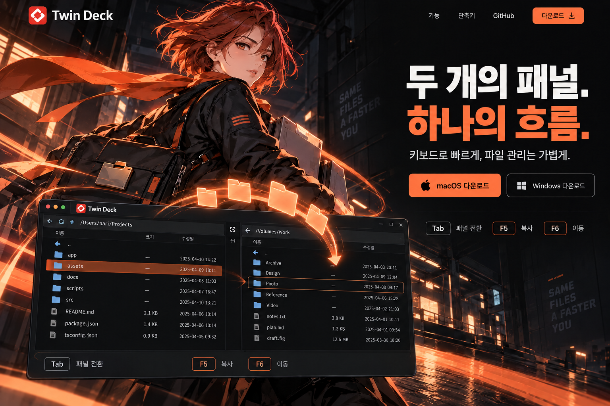

# 제품 소개 사이트 디자인과 작업 재개 안내

이 문서는 2026-10-26에 사용자가 선택한 사이트 컨셉과 현재 구현을 기록한다. 후속 작업은 이 문서 → [DESIGN.md](../DESIGN.md) → [site/README.md](../site/README.md) → 실제 사이트 순으로 확인한다. 앱 자체의 화면·테마 명세와 소개 사이트의 디자인은 구분한다.

## 1. 확정한 컨셉

**나이트 쿠리어**: 어두운 도시에서 파일을 전달하는 애니메이션풍 캐릭터로, 두 패널 사이의 빠르고 자연스러운 파일 이동을 표현한다.

- 처음 비교한 다섯 시안 중 **3번**을 선택했다. 기준은 아래의 기존 브랜드 로고를 반영한 수정 시안이다.
- 사이트는 **다크 테마 하나**만 제공한다. 시스템 테마·과거 저장값에 따라 밝아지지 않으며 전환 버튼도 없다. 앱이 제공하는 112가지 테마와는 별개다.
- 기존 **빨간 Twin Deck 아이콘과 정자체 `Twin Deck` 표기**를 유지한다. 주황색 사선 로고 등 새 심벌을 만들거나 기존 아이콘을 주황색으로 바꾸지 않는다.
- 검정·차콜 바탕, 따뜻한 흰색 글자, 주황색 강조를 전 페이지에 이어간다. 하단에서 파랑·밝은 테마로 전환하지 않는다.
- 핵심 문구는 “두 개의 패널. 하나의 흐름.”이다. 캐릭터와 실제 제품 화면, 다운로드 행동이 첫 화면에서 함께 읽히게 한다.

이 이미지는 **디자인 참고용 시안**이다. 이미지에 그려진 가상 앱 UI를 제품 화면으로 쓰지 않는다. 사이트의 실제 앱 화면은 아래의 기존 스크린샷을 별도로 배치한다. 영문 페이지는 같은 이름의 영어 UI 스크린샷(`docs/screenshots/en/`)을 쓴다. 화면 너비에 따라 시안과 정확한 위치·크기는 달라진다.

## 2. 이미지와 레이어

| 용도                  | 원본·구현 위치                                                                  | 유지할 조건                                                                                             |
| --------------------- | ------------------------------------------------------------------------------- | ------------------------------------------------------------------------------------------------------- |
| 캐릭터                | `site/assets/courier.webp`                                                      | 투명 배경. 짧은 적갈색 머리, 검은 재킷, 주황색 스카프, 파일 운송 가방·케이스를 가진 동일 캐릭터         |
| 캐릭터 작은 버전      | `site/assets/courier-small.webp`                                                | 같은 그림의 축소본. `srcset`에서 선택                                                                   |
| 도시 배경             | `site/assets/night-city.webp`                                                   | 인물·문구·앱 UI가 없는 야간 도시. 오른쪽 글자 영역은 어둡게, 아래쪽은 사이트 바탕색으로 자연스럽게 연결 |
| 배경 작은 버전        | `site/assets/night-city-small.webp`                                             | 같은 그림의 축소본. `srcset`에서 선택                                                                   |
| 브랜드 아이콘         | `apps/desktop/src-tauri/icons/128x128@2x.png`                                   | 빌드가 `assets/icon.png`로 복사. 공식 원본 유지                                                         |
| 첫 화면 앱            | `docs/screenshots/main.png`                                                     | 원본을 별도 ``로 표시. 가로세로 비율과 두 패널 보존                                                |
| 기능 안내 화면        | `docs/screenshots/drag-copy.png`, `preview-code.png`, `find.png`, `treemap.png` | 기존 실제 화면 사용                                                                                     |
| 앱 테마 예시          | `docs/screenshots/theme-dracula.png`                                            | 사이트는 어두운 앱 화면을 보여 준다. 앱의 라이트 테마 원본은 다른 문서에서도 사용하므로 삭제하지 않는다 |
| 폴더·빛의 곡선·화살표 | `site/index.html`의 `.transfer-effect` SVG                                      | 스크린샷 위에 독립 배치. 이미지에 합성하지 않음                                                         |

레이어는 **도시 → 캐릭터 → 실제 스크린샷 → 폴더 이동 효과**다. 본문과 다운로드·단축키 링크가 장식에 가려지지 않게 한다. `.transfer-effect`는 `aria-hidden`과 `pointer-events: none`으로 읽기·클릭을 방해하지 않는다.

원본 캐릭터·배경은 내장 `image_gen`으로 별도 제작한 후 WebP로 변환했다. 기존 WebP가 실제 사용 자산이므로 임시 생성 폴더가 없어도 사이트를 빌드할 수 있다.

### 이미지를 다시 만들 때

현재 `courier.webp`와 기준 시안을 정체성·분위기 참고로 제공하고 다음 조건을 지킨다.

- **캐릭터 지시:** 같은 성인 여성 나이트 쿠리어, 바람에 흐르는 짧은 적갈색 머리와 주황색 스카프, 검은 실용 재킷, 폴더 모양 잠금장치의 가방과 파일 케이스. 오른쪽을 향한 3/4 자세, 따뜻한 주황색 가장자리 빛, 애니메이션풍 세밀한 선화. 머리·스카프·손이 잘리지 않는 독립 실루엣과 충분한 여백. **실제 알파 투명 배경**. 건물·글자·로고·스크린샷·버튼·파일 궤적 제외.
- **배경 지시:** 검정·차콜과 절제된 주황색 불빛의 야간 산업 도시, 왼쪽의 건축 디테일·젖은 바닥 반사, 오른쪽에는 글자를 위한 어두운 여백. 아래쪽은 `#101012`로 연결. 같은 애니메이션풍 배경화. 인물·동물·문자·간판·로고·UI·화살표·파일 아이콘 제외.
- 새 자산은 기존 파일을 바로 덮어쓰기보다 별도 후보로 생성해 비교한다. 캐릭터는 투명 알파를 확인하고, 크기·용량이 다른 WebP를 함께 갱신한다.

## 3. 페이지 흐름

기존 링크와 앵커 ID는 유지한다.

| 순서·앵커          | 구성                                                                                                                                  |
| ------------------ | ------------------------------------------------------------------------------------------------------------------------------------- |
| 상단 내비게이션    | 기존 로고, 작업의 흐름·기능·나만의 공간, 언어 선택, 다운로드. 모바일에서는 섹션 링크를 숨김                                           |
| 첫 화면 `.hero`    | 데스크톱은 왼쪽 캐릭터·아래 앱 화면, 오른쪽 제목·다운로드·단축키. 모바일은 문구와 다운로드부터 보여 주고 캐릭터와 앱 화면을 이어 배치 |
| `#workflow`        | Tab/F5/F6/→ 키 버튼, 동작 설명, 실제 스크린샷. 눌러서 내용을 확인하는 기존 상호작용 유지                                              |
| `#features`        | 미리보기·파일 검색·용량 분석 탭. 실제 화면으로 제품을 설명                                                                            |
| `.more`            | 백그라운드 작업·압축·터미널·원격 파일 기능. 어두운 면과 절제된 주황색 선으로 이어짐                                                   |
| `#personal`        | 테마 수 카운트업, 설정 자유도 설명, Dracula 앱 화면                                                                                   |
| `#download`와 푸터 | 상단과 같은 도시 이미지를 어둡게 재사용. 다운로드·Homebrew·설치 안내 뒤 같은 바탕색으로 마무리                                        |

스타일은 `site/styles.css`에 있다. 컨테이너는 최대 1280px이며 모바일은 좌우 20px 여백이다. 기존 미디어 쿼리(767/1023/1279px 이하, 1600px 이상)를 확인한 뒤 위치를 수정한다. 캐릭터·배경·스크린샷·SVG가 각각 독립적이므로 한 레이어를 조정해 다른 레이어의 비율까지 바꾸지 않는다.

## 4. 모션과 대체 동작

| 대상             | 현재 동작                                                                                            | 모션 줄이기·대체 동작                                                    |
| ---------------- | ---------------------------------------------------------------------------------------------------- | ------------------------------------------------------------------------ |
| 캐릭터           | 약 7초 주기의 작은 상하 이동·회전으로 호흡감 표현                                                    | 정지                                                                     |
| 주황색 폴더 4개  | 6초 주기로 SVG 곡선을 따라 왼쪽에서 오른쪽으로 이동. 빛의 선과 화살표는 이동 방향을 유지             | 네 폴더를 곡선 위의 고정 위치에 표시                                     |
| 테마 숫자        | 처음 50% 이상 보일 때 한 번, 2초 동안 0 → 112. `1 - (1 - t)^3` 감속 곡선으로 초반은 빠르고 끝은 느림 | 112 즉시 표시. JavaScript나 IntersectionObserver가 없어도 최종 숫자 표시 |
| 테마 숫자 재진입 | 같은 페이지에서 다시 스크롤해 들어와도 반복하지 않음                                                 | 숫자 폭은 `tabular-nums`와 `min-width: 3ch`로 확보                       |
| 섹션·기능 상태   | 등장 모션, 기능 탭 전환, 패널 전환 안내                                                              | 콘텐츠와 기능 유지, 모션 생략                                            |

캐릭터와 폴더는 첫 화면 밖이나 다른 탭에서는 `.motion-paused`로 멈춘다. `prefers-reduced-motion`을 따른다. 스크롤을 가로채지 않고 별도 애니메이션 라이브러리도 추가하지 않았다.

**현재 구현의 범위:** 캐릭터는 단일 투명 이미지에 적용한 CSS 모션이다. 눈 깜박임이나 머리카락·스카프의 개별 리깅은 구현하지 않았다. 옛 시안의 모션 제안을 이미 구현된 것으로 간주하지 않는다.

## 5. 소스와 변경 지점

| 파일                      | 담당                                                        |
| ------------------------- | ----------------------------------------------------------- |
| `site/index.html`         | 한국어 기준 마크업, 레이어·SVG, 숫자의 `data-count-to`      |
| `site/styles.css`         | 색상·배치·반응형·SVG 모션 경로·정지 상태                    |
| `site/main.js`            | 화면 진입 감지, 모션 중단, 카운트업, 기능 버튼·탭·명령 복사 |
| `site/english.json`       | 정적 문구·속성의 영어 번역                                  |
| `site/language.js`        | 브라우저 언어·직접 선택·선택 기억                           |
| `scripts/build-site.mjs`  | 허용 자산만 복사, 한국어와 영어 정적 HTML 생성              |
| `scripts/check-site.mjs`  | 자산·링크·접근성 참조·다크 전용·번역 검사                   |
| `DESIGN.md`               | 현재 디자인 토큰과 적용 원칙                                |
| `.impeccable/design.json` | 디자인 검사·도구용 보조 정보                                |
| `.impeccable/config.json` | 요청된 발광 효과와 스크린샷 밀착 배치에 한정한 검사 예외    |

테마 수가 실제로 바뀌면 HTML 최종 숫자·`data-count-to`·한국어 설명·영어 번역을 함께 고친다. 새 공개 자산은 빌드 허용 목록에 넣는다. 번역에 없는 한국어를 추가하면 빌드가 실패한다.

## 6. 후속 작업과 검증

1. `git status --short`로 다른 작업을 확인하고, 이 문서와 현재 HTML/CSS/JS를 읽는다.
2. [site/README.md](../site/README.md)의 명령으로 빌드·검사·로컬 서버를 실행한다. 앱과 Rust 빌드는 필요 없다.
3. `http://localhost:4173/?lang=ko`와 `http://localhost:4173/en.html?lang=en`을 확인한다.
4. 데스크톱과 모바일(최소 320px), 다운로드·단축키와 SVG의 겹침, 이미지 로딩·가로 넘침을 확인한다.
5. 폴더 이동과 화면 밖 중단, 테마 수의 감속·최종값·1회 실행, 모션 줄이기를 확인한다.
6. 기능 탭의 방향키/Home/End, 설치 명령 복사, JavaScript 비활성화와 시스템 라이트 모드에서도 다크 유지 여부를 확인한다.

화면 캡처는 임시 검수물이다. 저장소에 반복해서 쌓지 말고 임시 디렉터리에 보관한다. 컨셉을 바꿀 때만 이 문서·`DESIGN.md`·디자인 보조 정보를 함께 갱신한다. 기준 시안은 배포 자산이 아니며 빌드 허용 목록에 넣지 않는다.

사이트 배포는 기존 GitHub Pages 워크플로를 따른다. 사이트 변경만으로 앱 버전·릴리스를 올리지 않는다. 실제 공개 여부를 확인하지 않고 배포 완료라고 기록하지 않는다.
